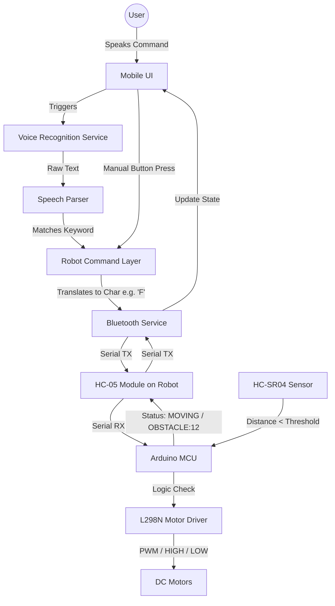

# Project Workflow

This document visualizes the complete end-to-end flow of the Panani VoiceBot, from a user speaking a command to the robot executing it.

## Visual Flow Diagram

## Step-by-Step Breakdown
1. **User Input**: The user initiates a command via the UI (either pressing a manual control button or using the voice recording button).
2. **Translation**: 
   - If Voice: The Speech-to-Text service returns a string. The Speech Parser checks this string against configured keywords (e.g., "go forward", "move up" -> `FORWARD`).
   - If Manual: The button directly maps to a `RobotCommand` enum.
3. **Transmission**: The `RobotCommand` is converted into a 1-character protocol (`F`, `B`, `L`, `R`, `S`) and written to the Bluetooth socket by the `BluetoothService`.
4. **Execution**: The HC-05 receives the character over RFCOMM and sends it to the Arduino's RX pin. The `main.ino` loop reads the char and triggers the corresponding `MotorController` function.
5. **Safety Override**: Regardless of the command, the `SensorManager` continuously polls. If distance < 15cm, it overrides the `MotorController` to stop.
6. **Telemetry**: The Arduino writes a status back to the HC-05 TX pin (e.g., `MOVING_FORWARD` or `OBSTACLE:12`). The App reads this, updates the `ConnectionManager` state, logs to `HistoryManager`, and updates the UI.
