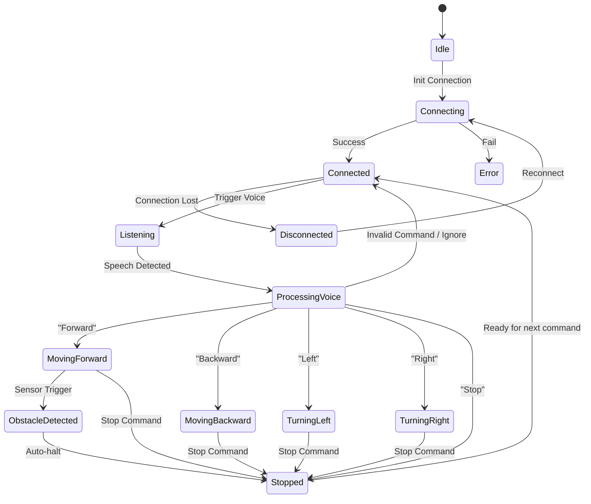

# Robot State Machine

This state machine outlines the valid operational states of the Panani VoiceBot from the perspective of the Android Application controller.

## Visual State Diagram

## State Definitions

| State Name | Description |
|------------|-------------|
| **Idle** | App is open, but Bluetooth is not scanning or connected. |
| **Connecting** | `ConnectionManager` is actively trying to establish an RFCOMM socket with the HC-05. |
| **Connected** | Socket established. Ready to send/receive data. |
| **Disconnected** | Connection was lost. App will attempt to auto-reconnect. |
| **Listening** | Microphone is active, waiting for the user to speak a command. |
| **Processing Voice** | Parsing the speech-to-text string to find a matching intent. |
| **Moving Forward** | `F` command sent, waiting for or receiving `MOVING_FORWARD` ack. |
| **Moving Backward** | `B` command sent, waiting for or receiving `MOVING_BACKWARD` ack. |
| **Turning Left** | `L` command sent, waiting for or receiving `TURNING_LEFT` ack. |
| **Turning Right** | `R` command sent, waiting for or receiving `TURNING_RIGHT` ack. |
| **Stopped** | `S` command sent, waiting for or receiving `STOPPED` ack. |
| **Obstacle Detected** | Received `OBSTACLE:xx`. Motors are halted by Arduino. App displays alert. |
| **Error** | Generic fault state (Bluetooth disabled, permission denied, etc.). |
