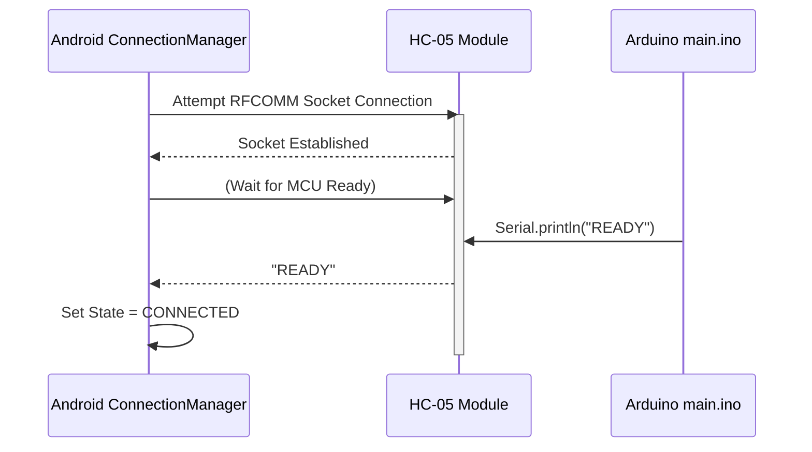
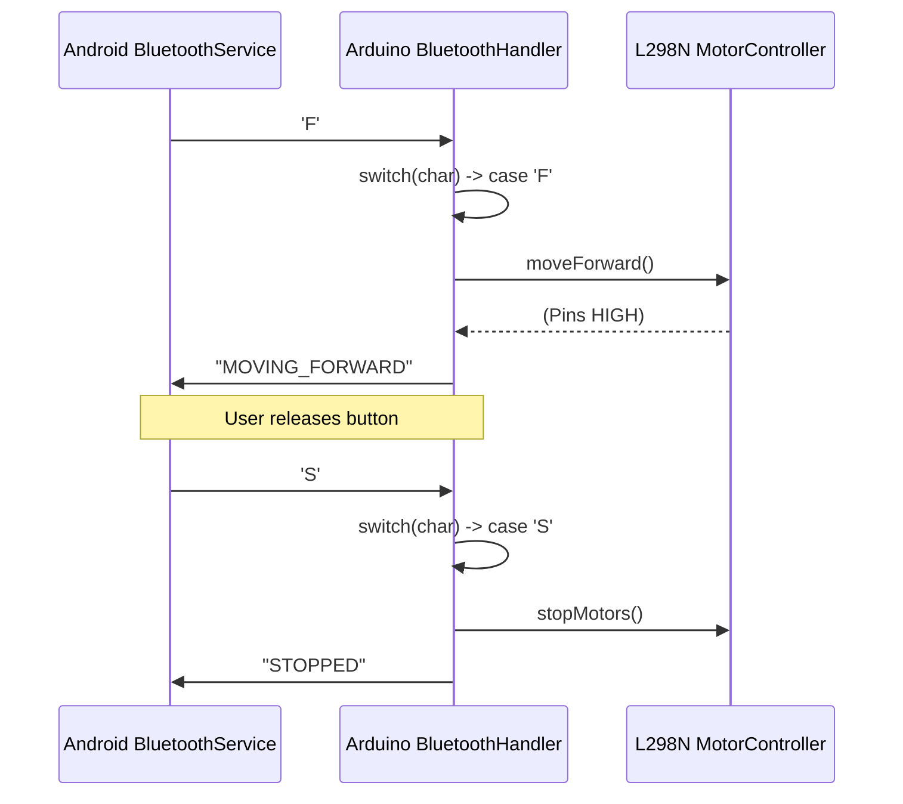
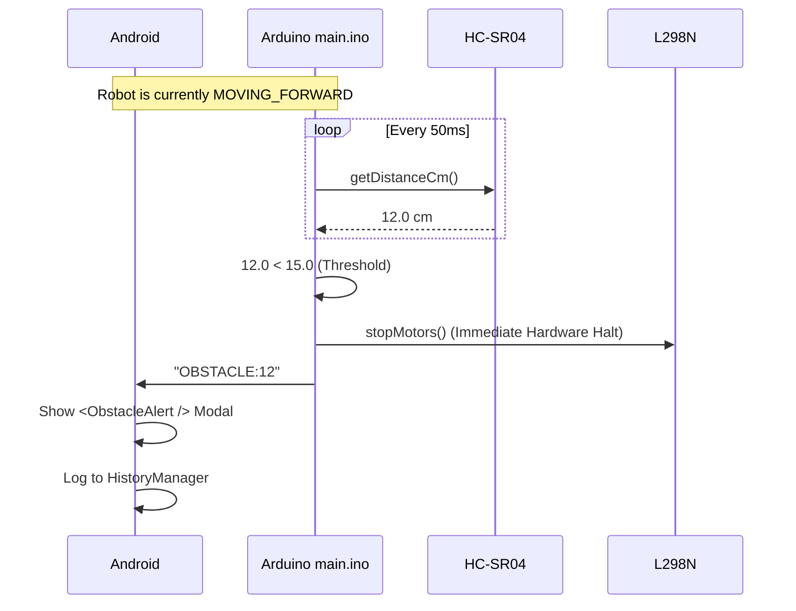

# Bluetooth Message Sequence Diagrams

This document outlines the precise sequences of messaging between the Android application and the Arduino HC-05 over the Serial protocol.

## 1. Connection & Handshake

## 2. Standard Movement (Manual Control)

## 3. Obstacle Interrupt (Sensor Override)

